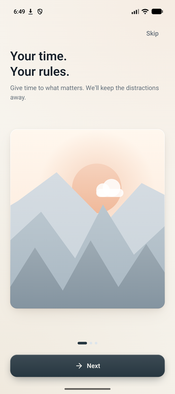
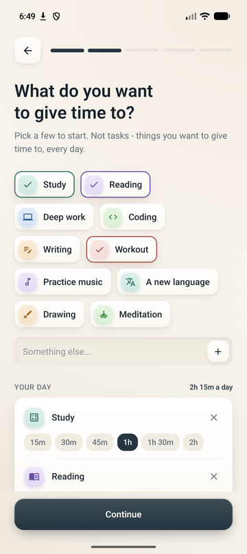
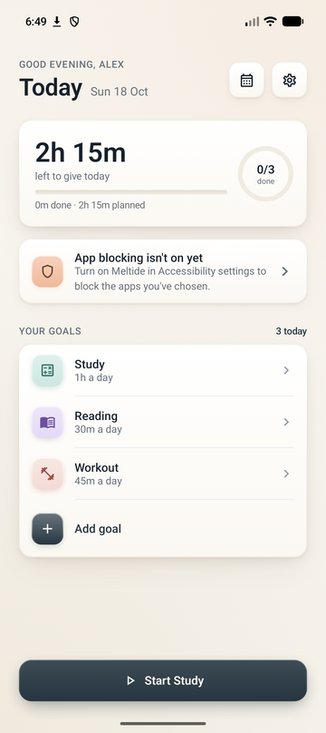
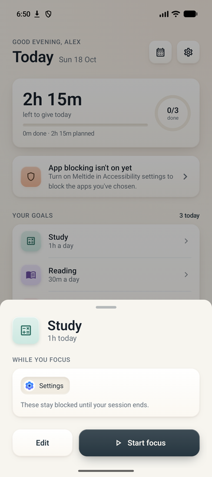
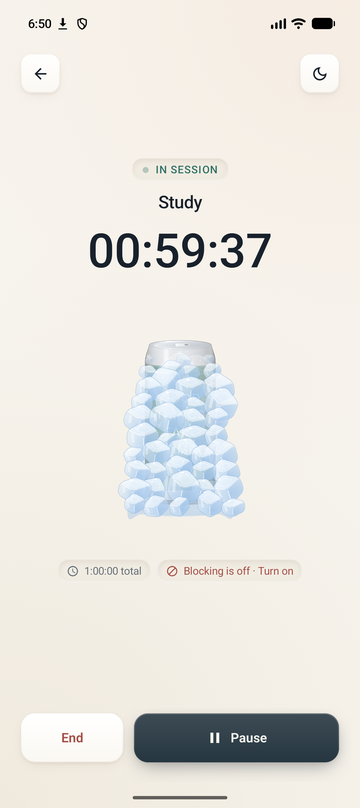
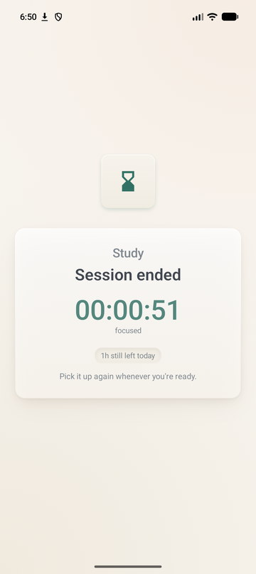
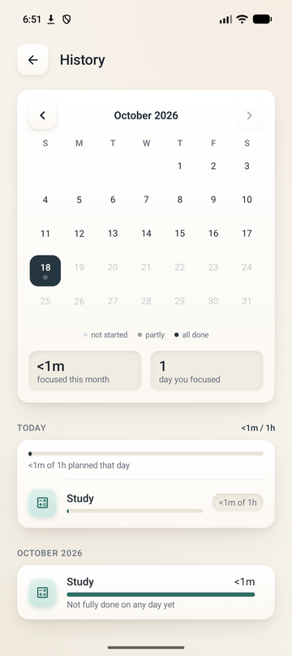
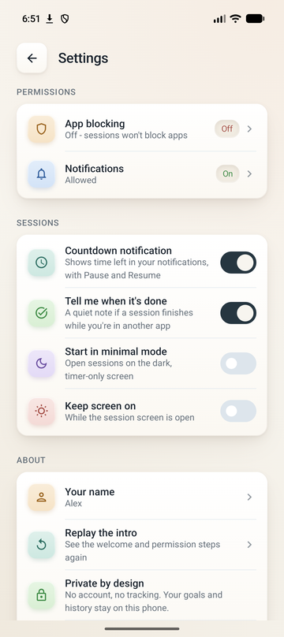
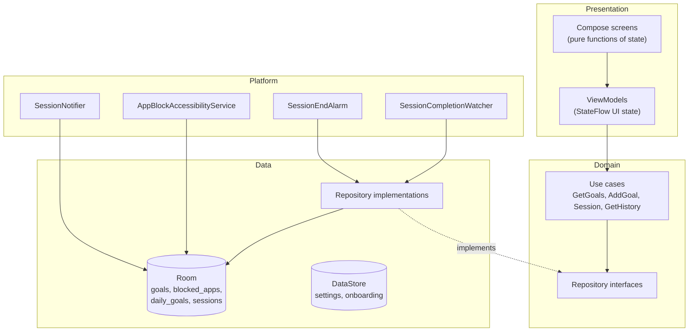

<p align="center">
  
</p>

<h1 align="center">Meltide</h1>

<p align="center">
  <b>Give your time to what matters. Meltide keeps the distractions away while it melts.</b><br/>
  A calm, offline Android app for daily focus goals, with per-goal app blocking.
</p>

<p align="center">
  <a href="https://github.com/imGOKUU/Meltide/actions/workflows/android.yml"></a>
  
  
  
  
</p>

---

## Overview

Most focus apps turn time into a game with streaks, scores, leaderboards and coins. Meltide does the opposite. You decide how much time something deserves each day, for example *Mathematics, 1 hour*. Starting it begins a countdown, and the apps you chose for that goal are blocked until the time is up. The only mechanic is that **the time left keeps going down**. An ice cube melts around a can as it goes.

The app doesn't tell you what you *should* do. It protects a decision you've already made.

- **No account, no backend, no tracking.** Everything stays on the phone.
- **Per-goal blocking.** *Mathematics* can block YouTube while *Projects* allows it.
- **Honest time accounting.** End a session early and the time you actually focused is credited, never rounded up into a "completion".

## Screenshots

| Welcome | Pick your goals | Today |
|:---:|:---:|:---:|
|  |  |  |
| **Review before starting** | **Focus session** | **Minimal mode** |
|  |  |  |
| **Session result** | **History** | **Settings** |
|  |  |  |

## Features

**Daily goals**
- Recurring daily goals with their own icon, colour and duration (any length, via an hours/minutes wheel or one-tap presets).
- Edit or delete goals at any time. Deleting is a soft delete, so history is kept.

**Focus sessions**
- A pre-session review sheet shows the duration and exactly which apps will be blocked, so a session never starts by accident.
- A clock-based countdown that survives the app being closed, the process being killed and the device rebooting.
- Pause and resume. Ending early takes a two-step confirmation, and the time spent is credited honestly.
- If you stop partway through, the next session continues with **what's left of today** instead of restarting the full duration.
- A melting-ice animation driven by the remaining time (Lottie).
- **Minimal mode:** a near-black, timer-only screen for leaving the phone face-up. The screen stays on and the system bars are hidden.

**App blocking**
- Per-goal block lists, chosen from the apps installed on the device, with search.
- An AccessibilityService notices when a blocked app opens during a running session and covers it with a calm "Not right now" screen.
- Blocking pauses with the session and stops the moment it ends.
- The UI is honest about state: if blocking is switched off, the session screen says so instead of claiming apps are blocked.

**Today and History**
- Today shows time left, a goals-done ring, a live card for the running or paused session, and one clear next action.
- History shows a month calendar where each day's dot reflects how much of its plan was done, the selected day's per-goal detail, and per-goal monthly totals.
- It reports facts only: no streaks, scores or badges, by design.

**Notifications**
- An ongoing countdown notification with Pause and Resume.
- A quiet "done" note when a session finishes while you're in another app.

**First run**
- An animated splash screen, a three-page illustrated intro, and a guided setup (name, goals, distracting apps, permissions, then "you're all set").
- Permissions are explained before they're requested, and both are optional.

**Design**
- A shared design system with two corner radii, layered warm-tinted shadows (Compose `dropShadow`/`innerShadow`), raised cards, inset wells and press feedback.
- Phone **and** tablet layouts, side-by-side layouts on short screens, and support for large system fonts.

## Tech stack

| Area | Choice |
|---|---|
| Language | Kotlin 2.2, coroutines and Flow |
| UI | Jetpack Compose (BOM 2026.02, Compose UI 1.10), Material 3, Navigation Compose |
| Architecture | MVVM with a domain layer (use cases), unidirectional state via `StateFlow` |
| DI | Hilt (incl. Hilt-injected `BroadcastReceiver`s and an `AccessibilityService`) |
| Persistence | Room (exported schemas, versioned migrations), Preferences DataStore |
| Platform | AccessibilityService, AlarmManager, notifications, SplashScreen API |
| Animation | Compose animation APIs, Lottie, animated vector drawables |
| Build | AGP 9, Gradle version catalog, KSP, R8 with resource shrinking, core library desugaring (`java.time` on API 24) |
| Quality | JUnit and coroutines-test, Room `MigrationTestHelper`, Android Lint, GitHub Actions |

## Architecture



```
com.meltide.app
├── core/            platform-facing pieces
│   ├── datastore/      AppPreferences (settings, onboarding, name)
│   ├── notifications/  SessionNotifier, SessionActionReceiver
│   ├── platform/       AccessibilityService, installed apps, permission checks
│   └── time/           TimeProvider, completion watcher, end-of-session alarm
├── data/            Room database, DAOs, entities, migrations, repository impls
├── domain/          repository interfaces, use cases
├── di/              Hilt modules
└── presentation/
    ├── components/     design system: surfaces, depth, buttons, dialogs, sheets
    ├── screens/        screens and their ViewModels
    └── theme/          colours, type, shapes, goal icons and accents
```

**Data model.** A `Goal` is a recurring intention ("Mathematics, 1h"). A `DailyGoal` is today's instance of it, holding the time allocated and completed plus a status. A `Session` is one countdown attempt. Each goal has its own `BlockedApp` rows.

## Engineering highlights

**A clock-based timer, never `countdown--`.** Remaining time is always derived from persisted timestamps:

```
remaining = allocated − (elapsedBeforePause + (now − runningSince))
```

So it stays correct across backgrounding, process death and reboots. `TimeProvider` is injected, which means tests move a fake clock by hand.

**A session repository that can't be corrupted by stale writes.** Sessions are written from several places (the session screen, the notification's Pause/Resume, the completion watcher, the blocking service and the end-of-session alarm). Every write goes through a `Mutex` and re-reads the row first, so a late "pause" from a stale copy can never revive a session that has already completed.

**Honest crediting.** Ending early or switching to another goal marks the session `INTERRUPTED` and adds the time actually focused to that day's `DailyGoal`. The next session is allocated only what's left of the day, and a completed goal won't restart that day.

**Background completion that survives the app freezer.** Testing showed Android's cached-app freezer suspends the process once you leave the app, so an in-process timer alone never noticed a session ending in the background. An `AlarmManager` alarm at the end time now records the completion and posts the "done" notification. It's exact where the system allows, and an inexact allow-while-idle alarm otherwise.

**A notification without a foreground service.** Because the timer is clock-based, the countdown notification uses the system chronometer (`setChronometerCountDown`) with `setTimeoutAfter`, so it stays correct even if the process dies. That avoids a foreground service and its policy overhead.

**Safe database evolution.** Room schemas are exported to `app/schemas/` and every version change ships with a `Migration`. There is deliberately **no destructive fallback**, so a missing migration fails in testing instead of wiping users' history. Migrations are tested against real rows with `MigrationTestHelper`.

**App blocking within Play policy.** The AccessibilityService listens only for window-state changes (`canRetrieveWindowContent="false"`), so it can't read screen content. The onboarding text doubles as the prominent disclosure Play requires, and the app never prevents itself from being disabled or uninstalled.

## Permissions and privacy

| Permission | Why | Required? |
|---|---|---|
| Accessibility service | Notice which app is in the foreground during a session so blocked apps can be covered | Optional; sessions still time your focus without it |
| `POST_NOTIFICATIONS` | Countdown and "done" notifications (Android 13+) | Optional |
| Installed apps (launcher query) | Pick which apps to block. Uses the launcher-intent query, so no `QUERY_ALL_PACKAGES` | n/a |

There's no internet permission, no analytics and no account. Goals, history and settings never leave the device.

## Testing

| Suite | What it covers | Run with |
|---|---|---|
| `SessionRepositoryImplTest` (JVM) | 19 cases on the time-accounting rules: start/attach, clock-based remaining time, pause/resume, ending early, switching goals, carrying today's remainder over, completion, a completed goal refusing to restart, stale writes, deleting a goal mid-session, and midnight | `./gradlew testDebugUnitTest` |
| `TimeFormatTest` (JVM) | Rounding rules: time left rounds up, time given rounds down, never shown in seconds | `./gradlew testDebugUnitTest` |
| `FocusMigrationTest` (instrumented) | Migrates a database filled with real rows, validates the schema, then reopens it through Room and the DAOs | see below |

The unit tests use in-memory fake DAOs and a hand-moved clock, so "an hour passes" takes no time.

Instrumented tests can run on any device or emulator:

```sh
./gradlew connectedDebugAndroidTest          # note: uninstalls the app afterwards
# to keep the app's data on a personal device:
./gradlew installDebug installDebugAndroidTest
adb shell am instrument -w com.meltide.app.test/androidx.test.runner.AndroidJUnitRunner
```

## Continuous integration

[`.github/workflows/android.yml`](.github/workflows/android.yml) runs on every push and pull request to `main`:

1. **build:** Android Lint, unit tests, and both debug and R8-minified release builds.
2. **instrumented:** boots an emulator and runs the instrumented tests, so a schema change can't merge without a working migration.

## Getting started

**Requirements:** Android Studio (recent, with AGP 9 support), the Android SDK with platform 37, and a device or emulator running Android 7.0 (API 24) or later. Gradle provisions the JDK toolchain automatically.

```sh
git clone https://github.com/imGOKUU/Meltide.git
cd Meltide
./gradlew installDebug          # build and install on a connected device
```

To try app blocking, open **Settings → Accessibility → Meltide** on the device and turn it on, or follow the prompt in the app's setup.


## Roadmap

- **"Keep the decision":** an override that adds a calm wait before opening a blocked app and records it as a fact, instead of a hard lock people learn to bypass.
- Scheduled sessions and a home-screen widget.
- A designed dark theme and a two-pane tablet layout.
- Localisation (moving all text to string resources).
- Guidance for manufacturer battery restrictions that can stop background services.

## Known limitations

- On Android 12+ without the "Alarms & reminders" permission, the end-of-session alarm is inexact, so the "done" note can arrive a few minutes late on an idle phone. The countdown itself is always correct.
- Some manufacturers (Samsung, Xiaomi and others) aggressively kill background services; app blocking may need the battery restriction lifted for Meltide.
- History lists a goal on a past day only if it was started that day.

## Author

Built by [@imGOKUU](https://github.com/imGOKUU).
